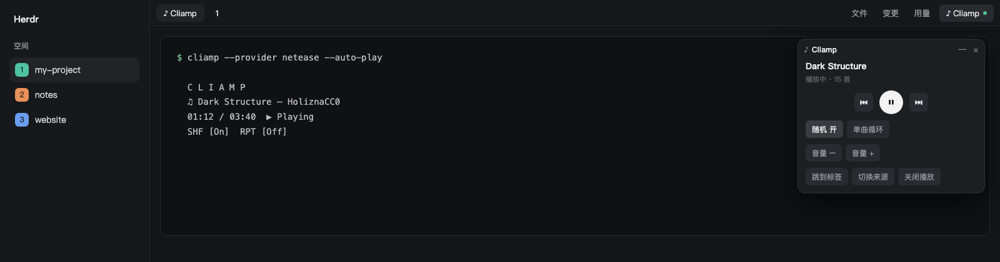
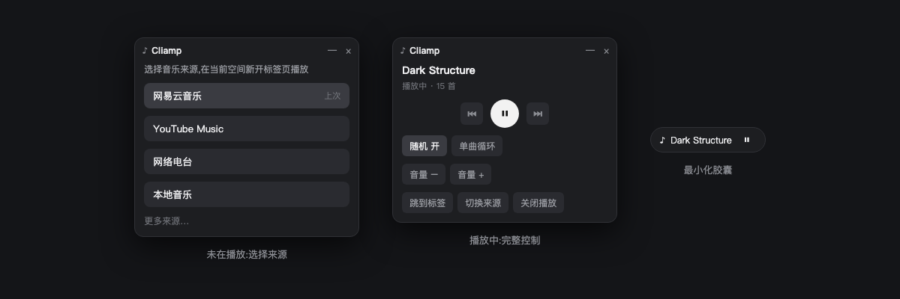

# herdr-cliamp

A top-right button + floating player for [Cliamp](https://github.com/bjarneo/cliamp) (the terminal music player) inside the [Herdr](https://herdr.dev) desktop app.
一个给 [Herdr](https://herdr.dev) 桌面端用的 [Cliamp](https://github.com/bjarneo/cliamp) 终端音乐播放器启动器:右上角一个按钮,点开是可拖动、可最小化的悬浮播放器。



## What it does / 功能

- **Pick a source, one click.** Lists Cliamp's providers (NetEase, YouTube Music, Radio, Local, Spotify, Qobuz, Tidal, Bandcamp, SoundCloud, …) and opens a `♪ Cliamp` tab **in the current space** running `cliamp --provider <name> --auto-play`. No more typing the command.
  选一个音乐来源,在当前空间新开 `♪ Cliamp` 标签页并启动,不用再敲命令。
- **Real player controls** via Cliamp's own CLI/IPC: previous / play-pause / next, shuffle on/off, repeat (off → all → one), volume ±3 dB, jump to the tab, switch source, stop.
- **Floating window** you can drag; **minimize** it to a small pill that shows the track and a play/pause button.
- The top-right button shows a green dot while Cliamp is running.



## Requirements / 前置条件

- Herdr desktop app (mods with `kind: "window"` overlays).
- [Cliamp](https://github.com/bjarneo/cliamp) v2.4.0+ on your `PATH` (tested with v2.4.0 on macOS). Some providers need `yt-dlp` / `ffmpeg` — see Cliamp's docs.
- Providers that reuse your browser login (e.g. NetEase, YouTube Music with `cookies_from = "chrome"`) are configured in Cliamp's own `~/.config/cliamp/config.toml` (`cliamp setup`).
  **macOS:** to read the browser cookies from inside Herdr, Herdr needs *Full Disk Access* (System Settings → Privacy & Security), otherwise Cliamp reports `could not find chrome cookies database`.

## Install / 安装

1. Copy both folders into your Herdr home:
   ```sh
   cp -r mods/cliamp-launcher mods/cliamp-player ~/.config/herdr-app/mods/
   ```
2. Shipped layouts are read-only, so clone yours first: `herdr-app do layout.clone '{"name":"main","as":"my-layout"}'` (use your own layout name; the Chinese build is `main-zh`).
3. In `~/.config/herdr-app/layouts/my-layout.json`, replace the `tabs` block with the row in [`docs/layout-snippet.json`](docs/layout-snippet.json) (keep your own tab mod name in `content.mod`; for `main-zh` it is `tabs-zh`). Save — Herdr hot-reloads.
4. Verify: `herdr-app check ~/.config/herdr-app/mods/cliamp-player` and `…/cliamp-launcher`.

## What it runs / 它会执行什么

The mods run these programs through Herdr's `exec` (found on `PATH`):

| Program | Why |
|---|---|
| `cliamp remote state` | poll playback state every 2 s (player) / 4 s (button) |
| `cliamp toggle/next/prev/shuffle/repeat/volume/status/stop` | the controls |
| `herdr-app do tab.new …` | open the `♪ Cliamp` tab in the current space |

No network access, and it reads no files outside its own folder.

## Notes / 注意

- Shuffle and repeat are persisted by Cliamp itself into its `config.toml` — that is Cliamp's behavior, not this mod's.
- Playback state updates lag 1–3 s after a command (Cliamp reports it asynchronously); the player re-polls after each action.
- The mod finds its terminal by the tab name `♪ Cliamp`; if you rename that tab, "jump to tab" / "switch source" can no longer find it.
- With the NetEase provider Cliamp stops at the playlist list after launch; pick a playlist in the tab (`--auto-play` does not start playback there).
- `cliamp-launcher` and `cliamp-player` each carry a copy of `lib.js` because a mod cannot import from another mod's folder.

## License

MIT
