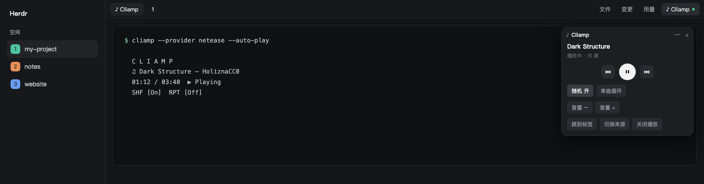

# Cliamp Launcher & Player

A small "♪ Cliamp" button sits at the right end of the tab bar. Clicking it opens a draggable floating player window that starts Cliamp (the terminal music player) from a list of providers, in a new tab of the current space, and then controls it: prev / play-pause / next, shuffle, repeat, volume, jump-to-tab, switch source, stop. The window can be minimized to a pill.

## What you see

- **Top-right button** (`cliamp-launcher`): a 104 px wide block at the right end of the tab-bar row, `chrome` background with the bar's bottom border. Content: a 26 px high rounded (6) chip, 12 px text "♪ Cliamp", `muted` text; `selected` background and `foreground` text while the player window is open; a 6 px `working`-colored dot after the text while Cliamp is running.
- **Player window** (`cliamp-player`, a `kind: "window"` overlay, `frame: "none"`, keyed `"cliamp"`): 300 px wide, `surface` background, 1 px `border`, radius 12. A 30 px title row: "♪ **Cliamp**" on the left, "—" (minimize) and "×" (close) 22 px squares on the right, hover `hover`.
- **Not playing:** a hint line (12 px, `muted`) "选择音乐来源,在当前空间新开标签页播放", then one 34 px row (radius 8, `raised`) per provider: 网易云音乐 (netease), YouTube Music (ytmusic), 网络电台 (radio), 本地音乐 (cliamp); the last-used one has `selected` background and a dim "上次" label. A "更多来源…" link toggles Spotify, Qobuz, Tidal, Bandcamp, SoundCloud, Mixcloud, 播客, Navidrome, Plex, Jellyfin, Emby, Yandex Music.
- **Playing:** title (14 px, semibold, truncated at 260 px) and a dim line "播放中/已暂停/已停止 · N 首"; a centered control row — 30 px square prev/next buttons and a 38 px round primary (`solid`/`solid_foreground`) play-pause; chips (28 px, radius 6, 12 px): "随机 开/关" and the repeat mode "顺序播放 / 列表循环 / 单曲循环" (highlighted `selected` when on); "音量 −" "音量 +"; "效果:<当前>" (cycles to the next visualizer) and "全部效果 ▾/▴" (expands a wrapped grid of 24 px chips, 11 px text, one per Cliamp visualizer, current one `selected`; "None" is shown as "关闭"); "跳到标签" "切换来源" "关闭播放".
- **Minimized:** a 34 px pill (radius 17, `surface`, 1 px `border`) with "♪", the track title (max 180 px) and a 24 px play/pause circle. Clicking the pill restores the window.

## How it behaves

- Clicking the top-right button toggles the window (open → close). The open overlay id is kept in shared state `cliamp.win`; the window clears it when it closes.
- Choosing a provider runs `herdr-app do tab.new --name "♪ Cliamp" --argv '["cliamp","--provider","<id>","--auto-play"]' --space <focused space>`. If an old `♪ Cliamp` terminal exists it is killed first. The chosen provider is stored in shared `cliamp.provider`; for 20 s afterwards the window shows "正在启动…".
- "Playing" is decided only by `cliamp remote state` succeeding (JSON `snapshot` with `state` `playing|paused|stopped`, `track.title`, `total`, `shuffle`, `repeat` `Off|All|One`). It polls every 2 s (button: 4 s); after each action it re-reads immediately and again after 1.2 s.
- Controls: `cliamp toggle | next | prev`, `cliamp shuffle on|off`, `cliamp repeat all|one|off` (cycling Off→All→One→Off), `cliamp volume <dB>` (read from `cliamp status`'s "Volume:" line, ±3, clamped −30…+6).
- Visualizer: `cliamp vis next` for the button, `cliamp vis <Name>` for a chip; the current one comes from `snapshot.visualizer`; the 35 names come from `cliamp vis list` (read once at start, with a built-in fallback list).
- "跳到标签" runs `pane.focus {terminal}`; "切换来源"/"关闭播放" run `cliamp stop` then `terminal.kill` on the `♪ Cliamp` terminal.
- The `♪ Cliamp` terminal is found in `terminals()` as a live terminal whose `where` ends with `/ ♪ Cliamp` (the hc terminal list has no argv).
- The window opens centered at first; the user drags it and `key: "cliamp"` makes Herdr remember the spot. Minimize state is per open; every open starts expanded.
- Window drag: the title row and empty areas drag the window; every control stops mouse-down propagation.

## Built from

- Mods `cliamp-launcher` (`mod.json`: `{"place":"none","title":"Cliamp"}`) and `cliamp-player` (`{"place":"none","title":"Cliamp Player"}`), each with a copy of `lib.js` (a mod cannot import another mod's folder).
- `herdr` functions: `exec`, `terminals`, `focused`, `run`, `openOverlay`, `closeOverlay`, `props`, `shared`, `setShared`, `notify`, `theme`. `gpui-kit` `View`, `div`; `gpui-base` `h_flex`, `v_flex`.
- Layout: the `tabs` block of a cloned layout becomes a `row` of the tab-bar block (flexible) and a `cliamp` block (`size.px` 104, `content.mod` `cliamp-launcher`). See `docs/layout-snippet.json`.
- Programs run (found on PATH): `cliamp`, `herdr-app`.

## Watch out

- Cliamp's `status` and `remote state` only work while a Cliamp instance (TUI or `--daemon`) is running; with none, the socket is missing and the window shows the provider list.
- Cliamp persists shuffle/repeat/visualizer to its own config; the mod does not.
- State lags a command by 1–3 s.
- Keep the tab name `♪ Cliamp`; the mod finds its terminal by it.
- Shared state is in memory: editing `shared.json` while Herdr runs has no effect.
- NetEase / YouTube Music reuse the browser login. On macOS Herdr needs Full Disk Access to read Chrome's cookie store.
- `herdr-app check` passes without Cliamp installed; the window then just shows the provider list.

## Done when

- `herdr-app check` passes for both mods and `herdr-app status` shows no errors.
- The button shows at the right end of the tab bar; clicking it opens the window and clicking again closes it.
- With Cliamp stopped the window lists providers; choosing "网络电台" opens a `♪ Cliamp` tab in the current space and music starts.
- While playing, next/prev/play-pause/shuffle/repeat/volume change `cliamp status` within ~3 s, and clicking an effect changes `cliamp remote state`'s `visualizer`.
- "—" shrinks the window to the pill showing the track title; clicking the pill restores it.
- "关闭播放" stops playback and removes the `♪ Cliamp` tab; the button's dot disappears.
